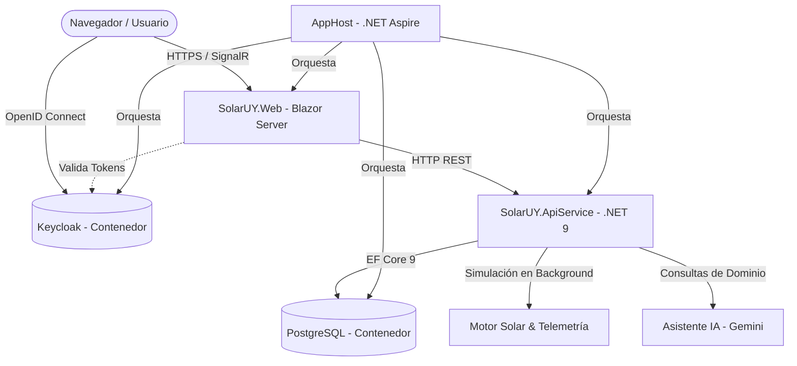

# SolarUY
**SolarUY** es una plataforma integral para el monitoreo, gestión, control operativo y mantenimiento de parques solares fotovoltaicos, nodos de conexión, inversores y paneles solares. Proyecto desarrollado en el marco del **Taller de Programación .NET 2026**.

El sistema combina telemetría en tiempo real mediante **SignalR**, un **motor único de simulación matemática determinista** adaptado al régimen solar de Uruguay (UTC−3), control de inyección a la red eléctrica, un sistema de gestión de mantenimientos para técnicos, analítica histórica y un **asistente inteligente en lenguaje natural (LLM)**.

---

## Arquitectura y Stack Tecnológico

| Capa / Componente | Tecnología | Descripción |
| :--- | :--- | :--- |
| **Orquestación y Hosting** | **.NET Aspire 13** | Levanta y supervisa en un único comando la Web, la API, PostgreSQL, Keycloak y el panel de observabilidad/métricas. |
| **Frontend Web** | **Blazor Server (.NET 9)** | Interfaz interactiva y reactiva con **SignalR**, componentes modulares y diseño responsive. |
| **Backend / API** | **ASP.NET Core Web API (.NET 9)** | Clean Architecture con controladores RESTful, endpoints documentados y servicios desacoplados. |
| **Base de Datos** | **PostgreSQL + EF Core 9** | Almacenamiento relacional de activos, historial de lecturas por minuto y agregaciones horarias de energía. |
| **Identidad y Seguridad** | **Keycloak (OpenID Connect / OAuth 2.0)** | Autenticación externa delegada en contenedor, gestión de usuarios y roles RBAC (`Administrador` y `Tecnico`). |
| **Simulador Solar & Fallas** | **C# / .NET 9 (Motor Puro)** | Emulación matemática de radiación astronómica para Uruguay, curvas estacionales e inyección controlada de fallas físicas. |
| **Inteligencia Artificial** | **Google Gemini / LLM** | Asistente conversacional con recuperación de contexto de dominio en tiempo real (*RAG liviano*). |
| **Pruebas y Calidad** | **xUnit + FluentAssertions + NetArchTest** | Suite con más de **795 pruebas automatizadas** unitarias y de reglas de arquitectura. |



---

##  Características Principales

### 1. Gestión de Topología y Activos Fotovoltaicos
- **Parques Solares**: Alta, baja lógica, edición, listado con búsqueda y capacidad total nominal.
- **Nodos de Conexión**: Agrupación física de paneles e inversor, con control de ubicación geográfica y estado.
- **Inversores**: Asociación de un único inversor por nodo, capacidad nominal en kW y control de inyección.
- **Paneles Solares**: Registro individual por número de serie, potencia (W), eficiencia (%) y reasignación dinámica entre nodos y parques.

### 2. Monitoreo y Telemetría en Tiempo Real
- **Cuadro de Mando del Parque**: Potencia activa en vivo (kW), energía acumulada en el día (kWh) y visualización gráfica.
- **Detalle de Nodo e Inversor**: Tensión DC/AC, corriente DC, frecuencia de red (50 Hz ± jitter) y temperatura interna en vivo.
- **Mapa de Salud de Paneles**: Grilla semafórica interactiva en tiempo real que clasifica cada panel como:
  - 🟢 **Óptimo**: Generando según la curva esperada.
  - 🟡 **Rendimiento Bajo**: Generación inferior al 50% de la esperada por suciedad o degradación.
  - 🔴 **Falla Crítica**: Circuito abierto o desconexión física.
  - ⚪ **Sin Sol**: Fuera de horas solares (atardecer a amanecer).
- **Alertas Automáticas de Fallas**: Notificaciones automáticas de sobretemperatura (> 75 °C), anomalías de frecuencia eléctrica o disparos de fuga a tierra.

### 3. Motor de Simulación Solar e Inyección de Fallas (Specs 036 y 037)
- **Calendario Solar para Uruguay**: Modela la declinación solar estacional en UTC−3 (desde 10,1 hs de sol en junio hasta 14,3 hs en diciembre con mediodía a las 12:45).
- **Motor Puro y Determinista**: Las lecturas son $f(\text{equipo}, \text{instante})$, garantizando que todas las pantallas y réplicas del servidor muestren números idénticos.
- **Simulador de Fallas Interactivo**:
  - *Corte total (circuito abierto)* en panel.
  - *Degradación severa (suciedad/hotspots)* al 30% de rendimiento.
  - *Sobretemperatura interna* de inversor (86 °C – 90 °C).
  - *Falla de aislamiento (fuga a tierra)* con desconexión de red según norma IEC 62109.

### 4. Gestión de Mantenimiento y Trabajo en Campo
- **Agendamiento Preventivo y Correctivo**: Reserva de fechas vinculadas a paneles, con asignación de técnicos habilitados.
- **Portal del Técnico ("Mis Mantenimientos")**: Vista dedicada para que los técnicos en terreno visualicen sus tareas pendientes y órdenes de trabajo del día.
- **Confirmación con Cierre Automático**: Al confirmar una reparación, el sistema actualiza el estado del panel y resuelve automáticamente las fallas simuladas activas.

### 5. Control Operativo de Inyección a la Red
- Desacople administrativo de inversores hacia la red eléctrica (apertura de contactores) con potencia activa forzada a 0 kW sin generar falsas alarmas.
- Activación y desactivación individual de paneles solares.

### 6. Históricos y Analítica Energética
- Persistencia idempotente de resúmenes por minuto (`InverterMinuteReadings`) y por hora (`ParkHourlyGenerations`).
- Gráficos y consultas agregadas por día, mes y año.
- Reconstrucción automática (*backfill*) de los últimos 30 días al arrancar sobre bases de datos vacías.

### 7. Asistente Conversacional con Inteligencia Artificial
- Chat integrado en la aplicación web para consultar en lenguaje natural el estado de los parques, equipos con alertas, producción energética y fallas activas.
- Integración con Google Gemini enriquecida con recuperación de contexto del dominio en tiempo real.

---

## Requisitos Previos

1. **.NET 9 SDK** instalado ([Descargar .NET 9](https://dotnet.microsoft.com/download/dotnet/9.0)).
2. **Docker Desktop** (o Docker Engine en Linux) en ejecución para que .NET Aspire inicie los contenedores de PostgreSQL y Keycloak.

---

## Cómo Ejecutar el Proyecto

Clona el repositorio e inicia toda la infraestructura con un solo comando:

```bash
git clone https://github.com/AgustinMS2/SolarUY.git
cd SolarUY
dotnet run --project SolarUY.AppHost
```

.NET Aspire se encargará automáticamente de:
- Descargar y levantar los contenedores de **PostgreSQL** y **Keycloak**.
- Aplicar las migraciones de Entity Framework Core.
- Importar el Realm de Keycloak (`SolarUY.AppHost/Realms/SolarUY-realm.json`) con roles y usuarios preconfigurados.
- Cargar los datos semilla (*seed data*) con parques, nodos, inversores, paneles y técnicos.
- Completar la historia de generación energética en segundo plano.

### Accesos y Servicios Expuestos

| Servicio | URL Local | Descripción |
| :--- | :--- | :--- |
| **Aspire Dashboard** | Mostrado en la consola al iniciar | Monitor de orquestación, métricas OpenTelemetry, logs distribuidos y trazas. |
| **Aplicación Web (Blazor)** | `http://localhost:5205` | Interfaz principal de usuario (requiere inicio de sesión vía Keycloak). |
| **API RESTful (Swagger)** | Asignado dinámicamente por Aspire | Endpoints de la API y documentación OpenAPI interactiva. |
| **Keycloak Admin Console** | `http://localhost:8080` | Servidor de identidad y gestión de usuarios/roles. |

### Credenciales de Prueba Preconfiguradas

| Usuario | Contraseña | Rol Asignado | Alcance y Permisos |
| :--- | :--- | :--- | :--- |
| `admin` | `admin123` | **Administrador** | Acceso total: CRUD de activos, control de red, simulación de fallas y agenda de mantenimientos. |
| `tecnico` | `tecnico123` | **Tecnico** | Acceso operativo: consulta de parques, telemetría y módulo *"Mis Mantenimientos"*. |
| `mrodriguez@solaruy.local` | `tecnico123` | **Tecnico** | Técnico especializado en terreno asignado a intervenciones de ejemplo. |

---

## Pruebas Automatizadas y Calidad

El proyecto fue desarrollado aplicando **TDD (Test-Driven Development)** y **Spec-Driven Development (SDD)**. La suite de pruebas cubre reglas de negocio, servicios, validaciones y arquitectura:

```bash
# Ejecutar todas las pruebas de la solución
dotnet test
```

### Resultados de la Suite:
- **795 pruebas automatizadas superadas (0 fallas)**.
- **Tests de Arquitectura** con `NetArchTest`: garantizan el desacoplamiento de capas, inyección de dependencias y aislamiento de controladores.
- **Análisis Estático**: Scripts listos para ejecución local con SonarQube en `SonarQube/analizar.ps1`.

---

## Estructura del Repositorio

```text
SolarUY/
├── SolarUY.AppHost/              # Orquestador .NET Aspire y realm de Keycloak
├── SolarUY.ApiService/           # Backend: Controladores, Servicios, Repositorios y Motor de Simulación
│   ├── Controllers/              # Endpoints REST (Parques, Nodos, Paneles, Mantenimientos, Telemetría)
│   ├── Data/                     # DbContext, migraciones EF Core y DbInitializer
│   ├── Domain/                   # Entidades del modelo de dominio y enums
│   ├── Dtos/                     # Data Transfer Objects para requests y responses
│   ├── Repositories/             # Capa de acceso a datos e interfaces
│   ├── Services/                 # Reglas de negocio, clientes de integración y BackgroundServices
│   └── Simulation/               # Motor solar matemático determinista y catálogo de fallas
├── SolarUY.Web/                  # Frontend Blazor Server (.NET 9) interactivo
│   ├── Components/Pages/         # Pantallas de gestión, mapas de salud, chat IA y monitoreo
│   ├── Hubs/                     # Clientes de SignalR para actualización en tiempo real
│   └── Services/                 # Clientes HTTP hacia la ApiService
├── SolarUY.ServiceDefaults/      # Extensiones transversales de resiliencia y telemetría OTLP
├── SolarUY.Tests/                # Suite de 795 pruebas unitarias y de arquitectura
├── specs/                        # 39 especificaciones formales SDD (spec.md, plan.md, tasks.md)
├── docs/                         # Arquitectura técnica, diagramas y constitución del proyecto
├── MEMORY.md                     # Bitácora viva del progreso del proyecto y estado de specs
└── README.md                     # Documentación principal de inicio rápido
```

---

## Documentación Adicional

- [docs/arquitectura.md](docs/arquitectura.md): Diagramas técnicos de componentes, capas, modelo de datos relacional y flujo SignalR.
- [docs/constitution.md](docs/constitution.md): Principios de diseño innegociables y convenciones del proyecto.
- [specs/](specs/): Trazabilidad completa de las especificaciones funcionales en formato EARS.
- [MEMORY.md](MEMORY.md): Registro histórico de fases completadas y decisiones técnicas.
