# Arquitectura de SolarUY

Diagramas técnicos de la solución. Están escritos en [Mermaid](https://mermaid.js.org/): GitHub los muestra directamente y en VS Code se ven con la vista previa de Markdown (extensión "Markdown Preview Mermaid Support"). Los principios de diseño están en [`constitution.md`](constitution.md) y el detalle de cada funcionalidad en [`../specs/`](../specs/).

**Contenido**

1. [Visión general](#1-visión-general)
2. [Capas de la API y reglas de dependencia](#2-capas-de-la-api-y-reglas-de-dependencia)
3. [Modelo de datos](#3-modelo-de-datos)
4. [Monitoreo en tiempo real](#4-monitoreo-en-tiempo-real)
5. [Cómo el simulador produce una lectura](#5-cómo-el-simulador-produce-una-lectura)
6. [Historia de generación](#6-historia-de-generación)
7. [Autenticación y autorización](#7-autenticación-y-autorización)
8. [Ciclos de vida (estados)](#8-ciclos-de-vida-estados)
9. [Consulta en lenguaje natural](#9-consulta-en-lenguaje-natural)
10. [Metodología de trabajo (SDD)](#10-metodología-de-trabajo-sdd)
11. [Ejecución y varias copias de la API](#11-ejecución-y-varias-copias-de-la-api)

---

## 1. Visión general

SolarUY es una aplicación .NET 9 orquestada con .NET Aspire. El navegador solo habla con la aplicación Blazor Server; esta consulta a la API con el token del usuario y recibe los datos en vivo por SignalR. La identidad la resuelve Keycloak (OpenID Connect) y los datos viven en PostgreSQL. No se interactúa con inversores reales: el simulador de la API ocupa el lugar de la API local del inversor.

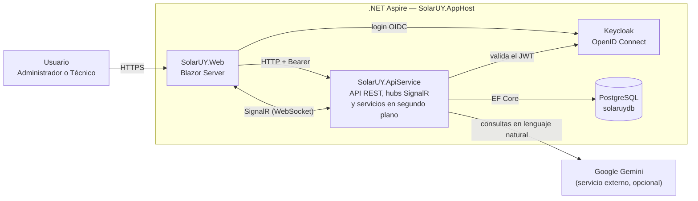

| Proyecto | Responsabilidad |
| :--- | :--- |
| `SolarUY.AppHost` | Orquesta Postgres, Keycloak (con el realm importado), la API y el Web, y sus dependencias de arranque. |
| `SolarUY.ApiService` | Controladores REST, hubs SignalR, servicios de negocio, repositorios, simulador y servicios en segundo plano. |
| `SolarUY.Web` | Páginas Blazor Server, clientes HTTP hacia la API y conexiones SignalR. |
| `SolarUY.ServiceDefaults` | Configuración común: salud (`/health`), telemetría y descubrimiento de servicios. |
| `SolarUY.Tests` | Tests unitarios de reglas de negocio y tests de arquitectura. |

---

## 2. Capas de la API y reglas de dependencia

Los servicios y repositorios son síncronos y no conocen HTTP. Los controladores solo hablan con servicios. Los tests de arquitectura (`SolarUY.Tests/Architecture`) verifican estas reglas en cada ejecución de `dotnet test`.

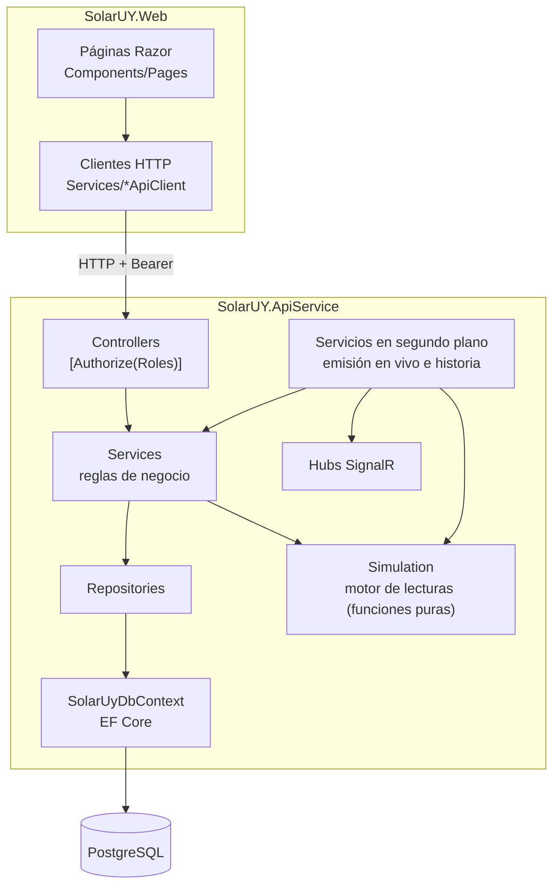

Reglas que cumple el código y que los tests de arquitectura comprueban:

- Los controladores no dependen de los repositorios.
- Los servicios y los repositorios no dependen de controladores ni de MVC.
- Todos los controladores exigen un rol (`[Authorize(Roles = ...)]`).
- Toda operación que modifica datos es solo para el Administrador, salvo una lista corta y justificada (confirmar un mantenimiento, reconocer una alerta y consultar al asistente).

---

## 3. Modelo de datos

Los usuarios y sus roles no están en la base: los gestiona Keycloak. Las líneas punteadas son referencias por identificador **sin llave foránea**, a propósito: dar de baja un equipo no debe borrar ni bloquear su historia ni sus fallas.

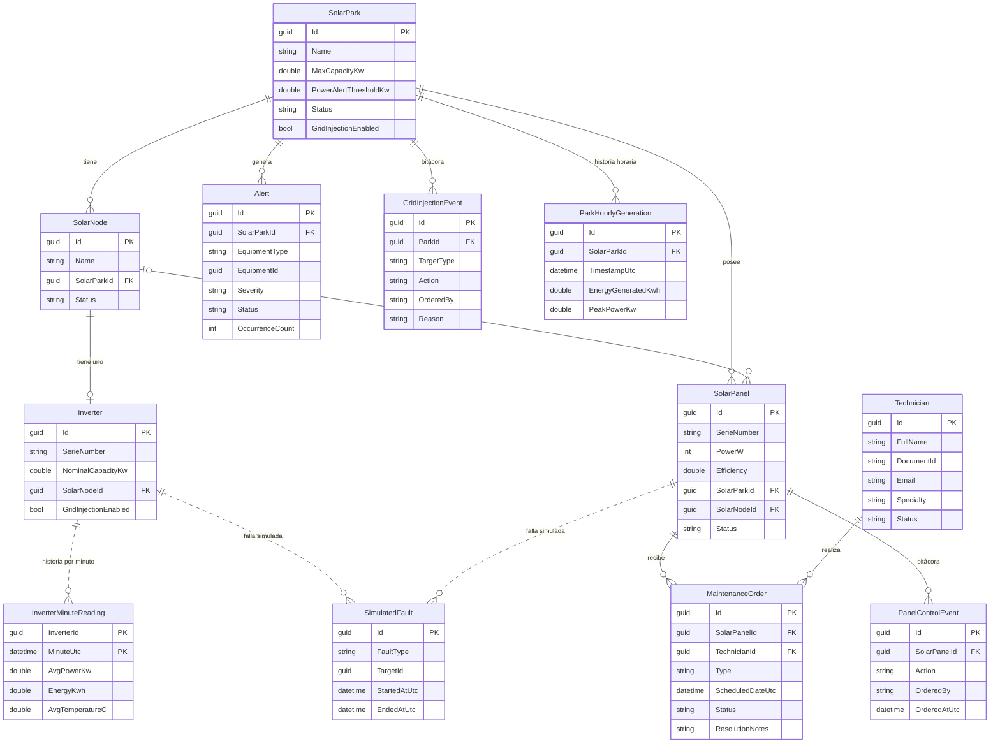

---

## 4. Monitoreo en tiempo real

Un servicio en segundo plano por tipo de pantalla (parque, nodo, panel y salud) despierta en los mismos instantes, múltiplos de `Simulation:IntervalSeconds` (5 segundos por defecto), y calcula todo sobre ese mismo instante. Por eso las cuatro pantallas muestran los mismos valores. Cada pantalla se suscribe al grupo SignalR de su equipo (`park-{id}`, `node-{id}`, `panel-{id}` y `park-health-{id}`) y solo recibe lo suyo.

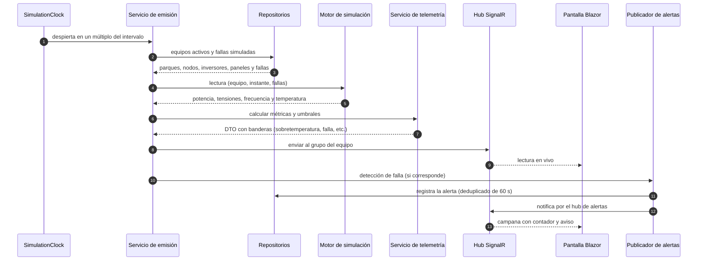

Las pantallas de monitoreo están en `/parques/{id}/monitoreo`, `/nodos/{id}/monitoreo`, `/paneles/{id}/monitoreo` y `/parques/{id}/salud` (mapa de salud). Si se pierde la conexión muestran "Reconectando…" y conservan la última lectura.

---

## 5. Cómo el simulador produce una lectura

La lectura es una función pura del equipo y del instante: el mismo equipo en el mismo instante da siempre el mismo valor, en cualquier pantalla y en cualquier copia del servidor. El ruido (nubosidad, variación de cada equipo) sale de un generador determinista, no de números al azar.

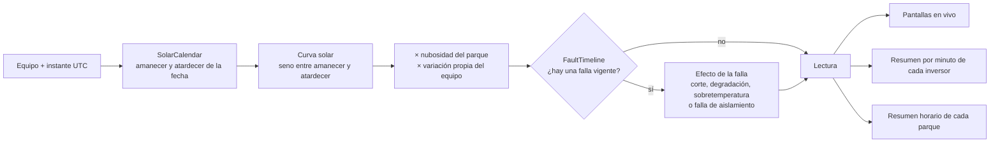

La duración del día cambia con la época del año (de unas 10,1 horas el 21 de junio a unas 14,3 el 21 de diciembre), y la potencia del parque es la suma de la de sus inversores.

---

## 6. Historia de generación

Al arrancar, la API completa en segundo plano la historia que falta, con la misma función del simulador, sin demorar el inicio. Un candado de PostgreSQL hace que, si hay varias copias de la API, una sola complete la historia a la vez. Luego, cada minuto guarda el minuto y la hora que se cerraron. El guardado es idempotente: repetirlo no duplica registros.

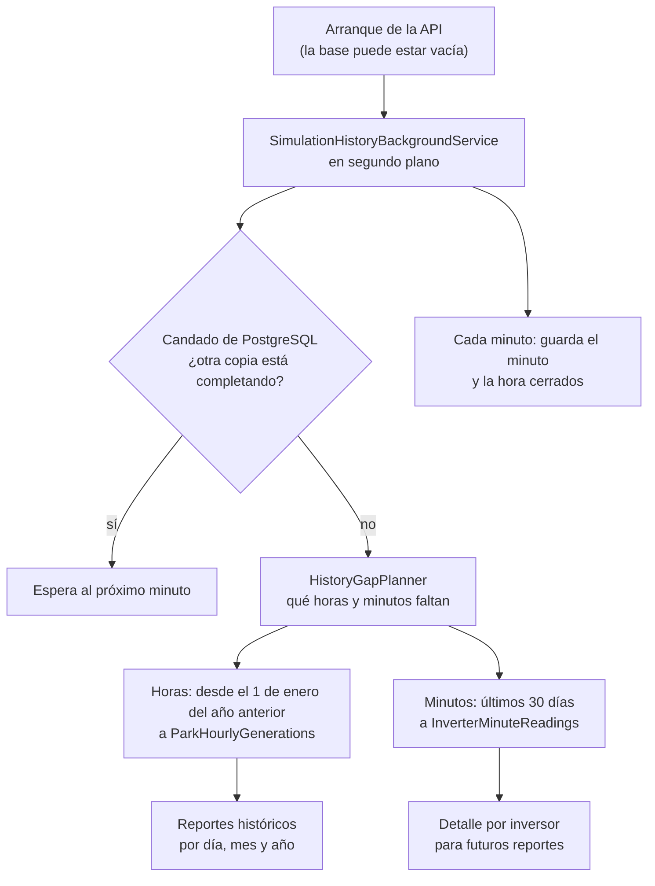

---

## 7. Autenticación y autorización

La autenticación es externa y estándar (OpenID Connect con Keycloak). Los roles de Keycloak son **Administrador** y **Técnico**. El Web guarda la sesión en una cookie y llama a la API con el token del usuario (renovándolo cuando vence); la API valida el JWT y aplica los roles.

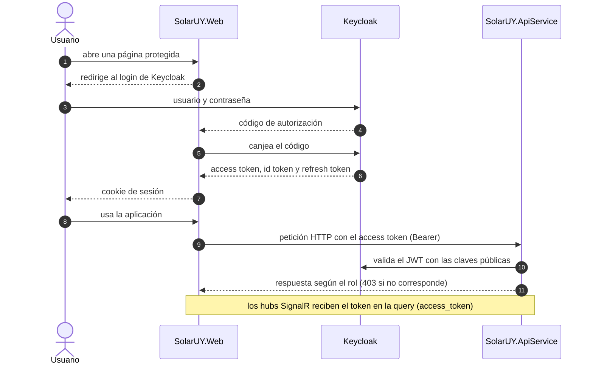

| Rol | Puede |
| :--- | :--- |
| Administrador | Todo: parques, nodos, inversores, paneles, técnicos, mantenimientos, control remoto, usuarios y roles, simulador de fallas. |
| Técnico | Consultar (monitoreo, históricos, alertas, asistente) y atender sus mantenimientos (ver y confirmar los suyos). |

---

## 8. Ciclos de vida (estados)

**Alerta de falla**

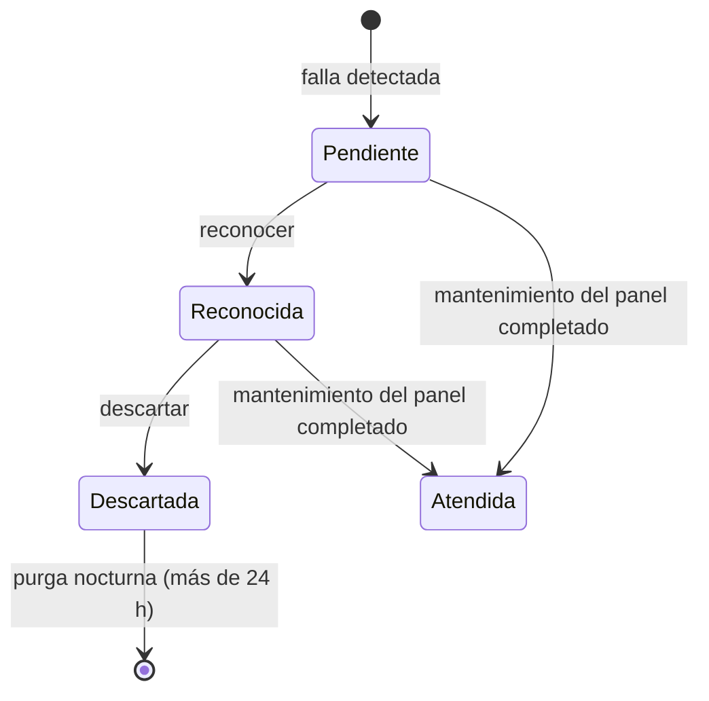

Una misma falla detectada de nuevo dentro de 60 s no crea otra alerta; la tercera detección en 5 minutos se consolida en una sola con un contador.

**Orden de mantenimiento**

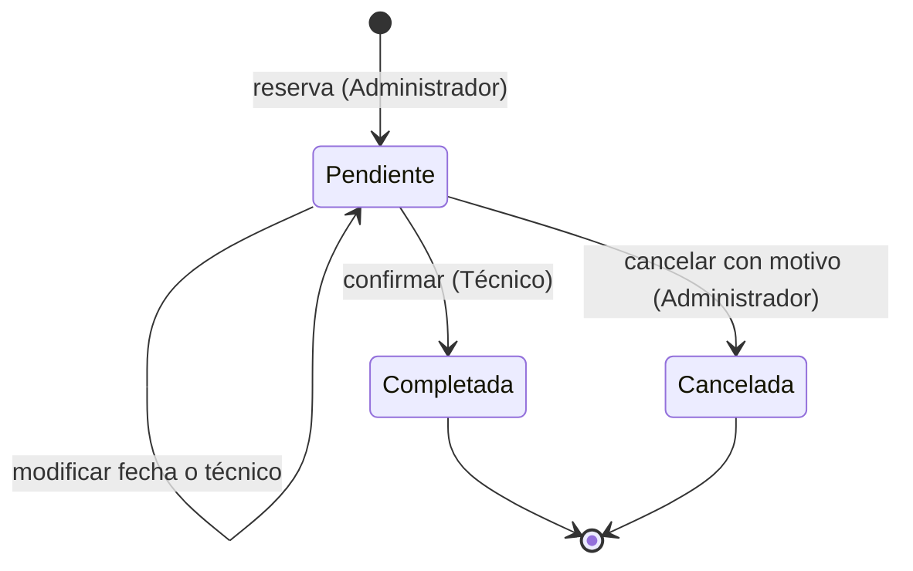

**Panel solar**

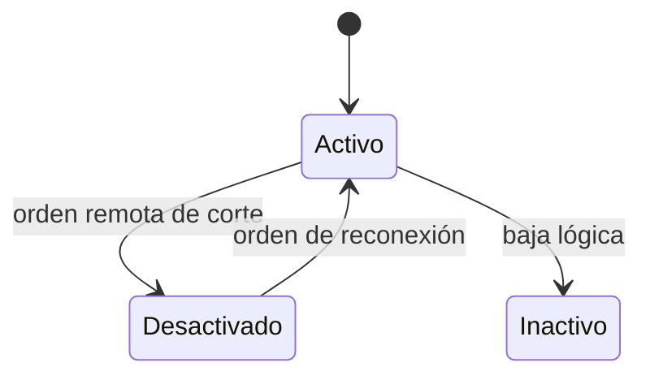

**Falla simulada (entorno de pruebas)**

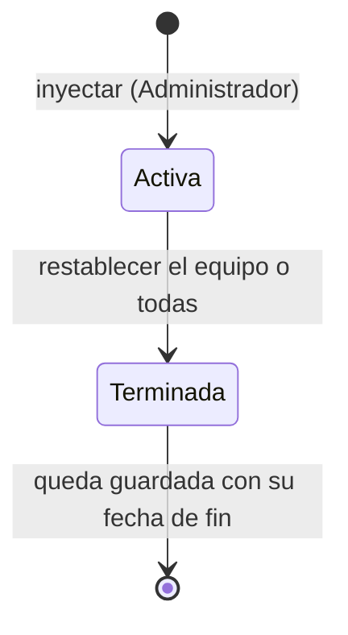

---

## 9. Consulta en lenguaje natural

Solo para consultas de información. Si hay una clave de Gemini configurada, el asistente le envía la pregunta junto con una foto del estado del sistema (parques, alertas, mantenimientos y generación); si no hay clave o Gemini falla, responde un asistente local que usa los mismos datos.

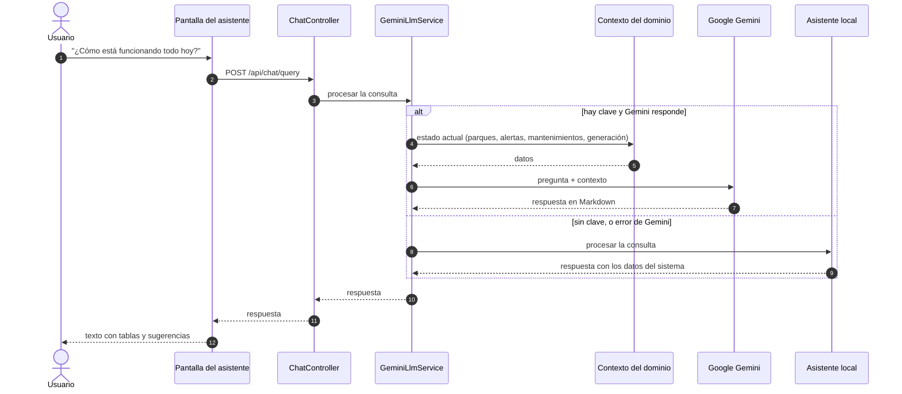

---

## 10. Metodología de trabajo (SDD)

El proyecto se desarrolla con IA siguiendo Spec-Driven Development: la especificación manda y ninguna fase se salta sin aprobación. La memoria del proyecto (`MEMORY.md`) se actualiza al terminar cada fase.

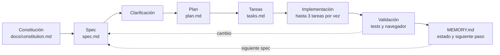

En la implementación solo las reglas de negocio de los servicios llevan tests unitarios (primero en rojo); la interfaz se valida en el navegador y los tests de arquitectura deben seguir en verde.

---

## 11. Ejecución y varias copias de la API

Se ejecuta con `dotnet run --project SolarUY.AppHost` (requiere Docker y .NET 9). El AppHost levanta hoy una copia de la API y una del Web.

Las piezas que podrían correr en más de una copia de la API están pensadas para convivir:

- **Lecturas deterministas:** dos copias calculan exactamente los mismos valores para el mismo equipo e instante.
- **Historia idempotente:** el guardado por minuto y por hora no duplica registros, y un candado de PostgreSQL evita que dos copias completen la historia a la vez.
- **Estado en la base:** las fallas simuladas, las bitácoras de control y las alertas viven en PostgreSQL, no en la memoria de una copia.
